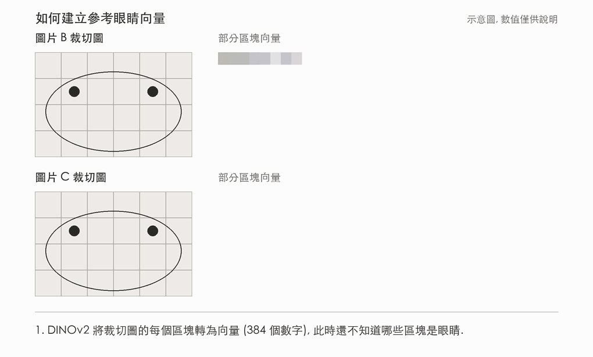

# 圖像分割

本專案比較兩種方法, 兩者都不進行模型微調:
**方法、結果與限制請見 [submission README](submission/README.md).**

- **YOLOE:** 以開放詞彙 (open-vocabulary) 分割模型, 透過提示詞 `eye` 與動物名稱描出動物與眼睛的輪廓.
   - 結論:
      - 由於眼睛在影像中所佔的像素較少, 即使將影像放大再進行預測, 仍有少數眼睛未被偵測到且眼睛的信心分數偏低.

- **YOLOE + DINOv2:** 先由 YOLOE 找出動物並進行圖像切割, 送入 DINOv2 來幫助定位眼睛特徵, 最後再以 OpenCV 影像處理描出眼睛輪廓.
   - 結論:
      - DINOv2 的 ViT (Vision Transformer) 架構搭配 YOLOE 儲存的眼睛輪廓進行疊加圖片區塊網格上, 接著比較每個區塊與參考眼睛的特徵相似度, 產生熱圖以定位眼睛.
      - 在測試樣本的 12 個標記眼睛中命中全部 12 個且沒有誤判, 
         - 純 YOLOE 則命中 9 個. 在 9 張新 COCO 圖片上, 眼睛召回率僅 `22.6%`. 但搭配 DINOv2 後提升至 `74.2%`
            - 但精確率由 `77.8% 降至 71.9%`
            - 速度也由 `5.56 FPS 降至 1.98-3.95 FPS`



## 資料夾結構 & 內容

```text
image-segmentation/
├── experiments/        先前的實驗, 不屬於最終流程
├── model/              模型權重 (不納入版本控制)
└── submission/         報告、資料集與最終流程
```

```text
submission/
├── README.md
├── requirements.txt                已安裝的 Python 套件版本
├── requirements-dev.txt            單元測試用的套件
├── data/
│   ├── 001-test_samples/           3 張測試樣本, 含手動標記的眼睛
│   └── 002-other_samples/          9 張其他 COCO 圖片、測試樣本副本與草稿眼睛標記
├── outputs/
│   ├── 001-test_samples_yoloe/            YOLOE 結果
│   ├── 001-test_samples_yoloe_dinov2/     裁切圖、熱圖與兩種輪廓結果
│   ├── 002-other_samples_yoloe/           YOLOE 結果
│   ├── 002-other_samples_yoloe_dinov2/    熱圖、兩種輪廓結果與 summary.csv
│   └── 002-other_samples_performance/     速度與準確度結果
├── reports/                        報告、圖表、量測結果與補充筆記
├── tests/                          單元測試
└── scripts/
    ├── config.yaml                                  資料、輸出、YOLOE 與量測設定
    ├── run_yoloe_test_samples.py                    在測試樣本上執行 YOLOE
    ├── run_yoloe_dinov2_test_samples.py             在測試樣本上執行 YOLOE + DINOv2
    ├── run_yoloe_and_dinov2_other_samples.py        在其他樣本上執行 YOLOE 與 YOLOE + DINOv2
    ├── evaluate_yoloe_and_dinov2_other_samples.py   其他樣本的速度與準確度
    ├── dinov2_eye_pipeline.py                       YOLOE + DINOv2 的共用步驟
    ├── measure_yoloe_eyes.py                        單一 YOLOE 結果的 R2 與 R3
    ├── measure_yoloe_dinov2_eyes.py                 單一 YOLOE + DINOv2 結果的 R2 與 R3
    └── export_submission_files.py                   所有結果的 R2 與 R3, 以及圖表, 輸出到 reports/files/
```

請從 [submission README](submission/README.md) 開始閱讀.

## 技術棧

| 項目 | 技術 |
|---|---|
| 程式語言 | Python 3.13 |
| 分割模型 | YOLOE `yoloe-26l-seg`, 透過 Ultralytics 8.4.203 |
| 眼睛特徵 | DINOv2 ViT-S/14 (含 registers), 透過 PyTorch 2.15.0 |
| 影像處理 | OpenCV 5.0 (GrabCut、輪廓) 與 NumPy 2.5 |
| 設定檔 | YAML (`submission/scripts/config.yaml`) |
| 資料 | COCO val2017 圖片, 以及用於準確度檢查的 COCO 標註 |


## 本地運行步驟

本子專案直接以 Python 執行, 不使用 Docker. 請在專案根目錄, 於 Apple Silicon Mac 或其他裝有 Python 3.13 的電腦上建立 `.venv` 並安裝套件:

```bash
python3.13 -m venv .venv
```

```bash
.venv/bin/python -m pip install -r image-segmentation/submission/requirements.txt
```

參考: [Ultralytics 安裝指南](https://docs.ultralytics.com/quickstart/).

## 分割動物與眼睛

共有兩種流程. 兩者都以 YOLOE 處理動物, 差別在於如何找出眼睛.
請在專案根目錄執行指令.

### 模型下載

第一次執行時會自動建立 `model/` 資料夾 (不納入版本控制) 並下載所需模型, 之後的執行會直接使用該資料夾中的模型.

| 模型 | 檔案 | 用途 | 下載時機 | 大小 |
|---|---|---|---|---|
| YOLOE | `yoloe-26l-seg.pt` | 分割動物與眼睛 | 流程一 | 約 80 MB |
| MobileCLIP 文字編碼器 | `mobileclip2_b.ts` | 將提示詞轉為文字特徵 | 流程一 | 約 250 MB |
| DINOv2 ViT-S/14 (含 registers) | `dinov2_vits14_reg4_pretrain.pth` | 產生區塊特徵以定位眼睛 | 流程二 | 約 88 MB |

### 流程一: YOLOE

```bash
.venv/bin/python image-segmentation/submission/scripts/run_yoloe_test_samples.py
```

COCO 模型沒有眼睛類別, 因此使用 YOLOE, 它可依照文字提示分割任意物體.
   - 所有設定皆在 `submission/scripts/config.yaml`.
      - 提示內容為 `submission/scripts/config.yaml` 中的動物名稱與 "eye_prompt".
   
   - 同一個模型會看每張圖兩次: 以 640 尺寸找動物, 以 1280 尺寸找眼睛
   
   - `submission/data/001-test_samples/` 中的每張圖片, 會在 `submission/outputs/001-test_samples_yoloe/` 產生一張標註圖 (動物為綠色, 眼睛為紅色) 與一個含信心分數的 JSON 檔.


### 流程二: YOLOE + DINOv2

```bash
.venv/bin/python image-segmentation/submission/scripts/run_yoloe_dinov2_test_samples.py
```

此流程只用 YOLOE 處理動物, 再將每隻動物裁切出來 最後以 DINOv2 找出眼睛.

**請先執行流程一, 因為此流程會讀取 `submission/outputs/001-test_samples_yoloe/` 中 YOLOE 的動物輪廓與眼睛輪廓.**


```text
腳本執行流程
YOLOE 動物輪廓 → 依外框裁切動物 → DINOv2 區塊特徵 → 參考眼睛的相似度 (熱圖) → 動物輪廓內的峰值 → 最多 2 個眼睛 → OpenCV做圖像後置畫出眼睛輪廓
```

此流程不訓練模型. 結果存放在 `submission/outputs/001-test_samples_yoloe_dinov2/`, 包含裁切圖、熱圖, 以及每種描輪廓方式各一個資料夾.


### 其他樣本

```bash
.venv/bin/python image-segmentation/submission/scripts/run_yoloe_and_dinov2_other_samples.py
```
在 `submission/data/002-other_samples/` 上執行兩種流程, 並以測試圖的 YOLOE 眼睛作為參考.

結果存放在
   - `submission/outputs/002-other_samples_yoloe/` 
   - `submission/outputs/002-other_samples_yoloe_dinov2/`


## 動物與眼睛分割及距離量測

### 結果摘要

**測試樣本:** 3 張圖片, 含 12 個手動標記的貓狗眼睛.

| 方法 | 命中眼睛 (共 12 個) | 誤判眼睛 | 雙眼距離 MAE, 相同 4 隻動物 | 右眼距離 MAE |
|---|---|---|---|---|
| YOLOE | 9 | 0 | 2.52 px | 1.82 px (2 對) |
| YOLOE + DINOv2, GrabCut | 12 | 0 | 4.31 px | 2.92 px (3 對) |
| YOLOE + DINOv2, HeatMap | 12 | 0 | 2.67 px | 2.09 px (3 對) |

**註：可以發現雖然


**其他樣本:** 12 張圖片, 沒有眼睛標記.

| 方法 | 輸出眼睛 | 有兩個眼睛的動物 (共 25 隻) | 右眼配對 |
|---|---|---|---|
| YOLOE | 18 | 7 | 2 |
| YOLOE + DINOv2, 任一方式 | 48 | 23 | 15 |

**其他樣本中 9 張新 COCO 圖片的速度與準確度:**

| 方法 | FPS | 眼睛精確率 | 眼睛召回率 | 眼睛 F1 | 雙眼距離 MAE |
|---|---|---|---|---|---|
| YOLOE | 5.56 | 77.8% | 22.6% | 0.35 | 1.95 px (2 隻動物) |
| YOLOE + DINOv2, GrabCut | 1.98 | 71.9% | 74.2% | 0.73 | 1.71 px (8 隻動物) |
| YOLOE + DINOv2, HeatMap | 3.95 | 71.9% | 74.2% | 0.73 | 2.17 px (9 隻動物) |

YOLOE 的貓狗輪廓與 COCO 遮罩相當吻合: 21 隻中找到 19 隻, 類別全部正確, 遮罩 AP50 為 0.901, AP50-95 為 0.597.
速度是在 Apple M4 Pro 上使用 MPS 測得. 詳情請見[報告 7](reports/07_performance_on_other_samples.md).

- **標記未經審閱:** 所有眼睛標記都由 Claude Code 製作, 包含其他樣本的草稿標記, 沒有經過人工審閱.
- **重複圖片:** 其他樣本包含 3 張測試樣本的副本.

## 限制

### YOLOE

- **漏掉許多眼睛:** 在測試樣本的 13 個標記眼睛中找到 9 個, 在 9 張新 COCO 圖片的 31 個標記眼睛中只找到 7 個 (召回率 22.6%). 動物沒有兩個眼睛就無法量測.
- **新圖片沒有右眼配對:** 其他樣本上的 2 對都來自測試樣本的副本.
- **眼睛信心分數低:** 測試樣本上的眼睛信心分數只有 0.12-0.35, 因此門檻必須維持在 0.1.
- **可能合併動物:** 在 `000000333772.jpg` 中, 它用一個輪廓框住 2 隻貓.
- **參數依測試樣本調整:** 提示、門檻與輸入尺寸都是依 3 張測試樣本選定, 因此這些分數可能偏樂觀.
- **授權:** YOLOE 文件中維護者的留言表示, 正式環境使用需遵守 AGPL-3.0 或取得企業授權, 商業使用前請先確認.

### YOLOE + DINOv2

以下限制適用於兩種描輪廓方式.

- **無法回報「沒有眼睛」:** 每隻動物至少會輸出一個眼睛, 即使看不到眼睛也一樣, 因此可能出現誤判, 例如耳朵或身上的斑塊. 尚未測試最低分數門檻.
- **依賴 YOLOE:** 動物輪廓與參考眼睛都來自 YOLOE. 它漏掉的動物不會有眼睛, 它合併的動物會被視為一隻, 這在 `000000333772.jpg` 造成橫跨 2 隻貓、無效的 137.6 px 雙眼距離.
- **特徵較粗:** 每個 14 px 區塊涵蓋多個原始像素, 因此小或模糊的眼睛可能合併或失去細節. 部分極小的結果, 例如 2.45 px, 需要檢查.
- **新圖片有誤判:** 以 9 張新 COCO 圖片的草稿標記比對, 計分的 32 個眼睛中有 9 個是誤判 (精確率 71.9%).
- **動物種類有限:** 只處理貓與狗, 並使用貓狗的參考眼睛.
- **速度較慢, 且依動物數量增加:** DINOv2 在 Apple M4 Pro 上每隻動物約需 97 ms, 因此動物多的圖片耗時較長.

**GrabCut 方式**

- **測試樣本上的距離誤差較大:** 相同 4 隻動物為 4.31 px, HeatMap為 2.67 px, YOLOE 為 2.52 px.
- **輪廓可能使中心點偏移:** 在 003 的狗上得到 55.47 px, 標記值為 49.33 px.
- **需要明顯對比:** 深色、模糊或低對比的眼睛, 可供分離的顏色資訊很少.
- **最慢的步驟:** GrabCut 在 CPU 上每隻動物約需 122 ms, 整體為 1.98 FPS.

**HeatMap方式**

- **輪廓較鬆:** 在測試樣本上涵蓋的面積接近 YOLOE 眼睛的兩倍, 與 YOLOE 的多邊形 IoU 為 0.51-0.54, GrabCut 則為 0.66-0.69.
- **不使用影像邊緣:** 它只描熱圖, 因此無法貼合眼睛的實際邊緣.
- **等高線為固定選擇:** 使用 50% 高度, 較低的高度在先前的測試中曾漏掉一個眼睛.

### 兩種方法皆有

- **驗證規模小:** 只有 3 張測試樣本有眼睛標記, 參數也是依這些圖片選定.
- **002 的狗不確定:** 標記值為 78.50 px, 兩種方法都得到 73-75 px.
- **只有像素單位:** 距離不是實際尺寸, 也會受頭部角度與遠近影響.
- **右眼規則:** 假設頭部朝前且直立.


## 量測眼睛距離

有兩支腳本會印出單張圖片的計算過程, 兩種方法各一支. 模式由 `scripts/config.yaml` 的 `both_eyes` 設定:
`both-eyes` 量測每隻動物的雙眼 (R2), `right-eye-pair` 量測每一對動物的右眼 (R3).

YOLOE:

```bash
.venv/bin/python image-segmentation/submission/scripts/measure_yoloe_eyes.py --json image-segmentation/submission/outputs/001-test_samples_yoloe/002-coco-sample.json
```

YOLOE + DINOv2, 使用 `grabcut/` 或 `heatmap_level/` 資料夾中的 JSON 檔:

```bash
.venv/bin/python image-segmentation/submission/scripts/measure_yoloe_dinov2_eyes.py --json image-segmentation/submission/outputs/001-test_samples_yoloe_dinov2/grabcut/002-coco-sample.json
```

兩者都適用於任一組圖片. 若要一次量測所有結果, 並儲存報告 3 與報告 4 使用的 CSV 檔, 請依下方說明執行 `export_submission_files.py`.

## 單元測試

單元測試使用小型的人工輸入, 不需要模型權重、GPU 或資料集. 它們檢查程式邏輯, 模型的準確度則由其他樣本的評估腳本負責.

請在專案根目錄安裝測試套件並執行:

```bash
.venv/bin/python -m pip install -r image-segmentation/submission/requirements-dev.txt
```

```bash
.venv/bin/python -m pytest image-segmentation/submission/tests
```

測試檔案位於 `submission/tests/`:

* `test_measure_yoloe_eyes.py`
   * 檢查眼睛中心點與距離的計算、每隻動物只保留信心最高的 2 個眼睛, 以及雙眼距離與右眼距離的量測與略過規則.
* `test_dinov2_eye_pipeline.py`
   * 檢查熱圖峰值的尋找、雙眼的間距與分數規則、參考眼睛向量的建立, 以及裁切座標的換算.
* `test_run_yoloe_test_samples.py`
   * 檢查重複偵測的移除, 以及如何判斷眼睛屬於哪一隻動物.

## 重現結果

請在專案根目錄依序執行:

```bash
.venv/bin/python image-segmentation/submission/scripts/run_yoloe_test_samples.py
```

```bash
.venv/bin/python image-segmentation/submission/scripts/run_yoloe_dinov2_test_samples.py
```

```bash
.venv/bin/python image-segmentation/submission/scripts/run_yoloe_and_dinov2_other_samples.py
```

```bash
.venv/bin/python image-segmentation/submission/scripts/export_submission_files.py
```

```bash
.venv/bin/python image-segmentation/submission/scripts/evaluate_yoloe_and_dinov2_other_samples.py
```

最後一個指令需要 `../experiments/data/coco_annotations/` 中的 COCO 標註檔.

在新環境中安裝套件:

```bash
.venv/bin/python -m pip install -r image-segmentation/submission/requirements.txt
```
