# YOLO11 Nano Segmentation (`yolo11n-seg`)



YOLO11n-seg is the smallest instance-segmentation model in the Ultralytics
YOLO11 family. For every object in an image it predicts a **class**, a
**bounding box**, a **confidence score** and a **pixel mask**, in a single
forward pass ("you only look once").

| Property | Value (Ultralytics published figures) |
|---|---|
| Parameters | ~2.9 M |
| Compute | ~10.4 GFLOPs at 640x640 |
| Pretraining data | COCO 2017 (80 classes, instance masks) |
| Input size | 640x640 (letterboxed) |
| COCO val accuracy | ~38.9 box mAP50-95, ~32.0 mask mAP50-95 |

Check the [Ultralytics segmentation docs](https://docs.ultralytics.com/tasks/segment/)
for current numbers; they change between releases.

## How inference works

The animation above follows these stages.

1. **Pre-processing.** The image is resized with aspect ratio kept (long side 640)
   and padded (letterbox) with gray. At predict time the short side is padded only
   to a multiple of 32 (e.g. 640x448); training batches are square 640x640. Then it
   is scaled to 0-1 and turned into a channels-first tensor.
2. **Backbone** extracts features at three scales. It is built from strided
   `Conv` layers, `C3k2` blocks (a cheaper CSP-style residual block), an `SPPF`
   block (fast spatial pyramid pooling for larger receptive field) and a `C2PSA`
   block (partial self-attention for global context).
3. **Neck (PAN-FPN)** mixes the scales. A top-down path upsamples deep, semantic
   features and concatenates them with shallow, detailed ones. A bottom-up path
   then feeds fine detail back to the deeper levels. Output: feature maps P3, P4,
   P5 at strides 8, 16 and 32 (80x80, 40x40, 20x20 for a 640 input), which handle
   small, medium and large objects.
4. **Segment head** is anchor-free and decoupled. At each grid cell of each scale
   it predicts:
   - box distances, as a distribution (Distribution Focal Loss style regression),
   - 80 class scores,
   - **32 mask coefficients**.
5. **Proto branch.** In parallel, a small module upsamples the P3 features into
   **32 prototype masks** at 160x160 (1/4 of the input). The prototypes are shared
   by the whole image; they are not tied to any one object.
6. **Mask assembly.** After confidence filtering and Non-Max Suppression (NMS),
   each surviving detection's 32 coefficients are linearly combined with the 32
   prototypes: `mask = sigmoid(coefficients @ prototypes)`. The mask is cropped
   to the detection's box, upsampled to the image size and thresholded at 0.5.

This "prototypes + coefficients" design (from YOLACT) is why the model is fast:
the expensive mask computation is done once per image, and each extra object only
costs a small matrix multiplication.

## Step-by-step calculation (animated)



The animation (about 63 s loop, 9 steps of 7 s, with a progress bar) walks through
one forward pass on a 448x640 input with real tensor shapes and computed numbers:

| Step | What is calculated |
|---|---|
| 1. Pre-processing | resize, pad, divide by 255, HWC to CHW |
| 2. One Conv block | 3x3 kernel sliding with stride 2, then BatchNorm, then SiLU, with the actual sums |
| 3. Backbone | `Conv` / `C3k2` / `SPPF` / `C2PSA`: 3@448x640 down to 256@14x20, taps P3/P4/P5 |
| 4. Neck (PAN-FPN) | upsample + concat + C3k2 (top-down), strided Conv + concat + C3k2 (bottom-up) |
| 5. Segment head | box (64 = 4x16), class (80), mask (32) branches: 176 numbers per cell, 5,880 candidates |
| 6. Decode | softmax over 16 bins, expected value, distance x stride, sigmoid class score |
| 7. NMS | score threshold 0.25, per-class IoU suppression at 0.7 (IoU values computed from the drawn boxes) |
| 8. Prototypes | P3 out, then Conv, ConvTranspose (x2), Conv, Conv 1x1 gives 32@112x160 |
| 9. Mask assembly | `sigmoid(coefficients @ prototypes)`, crop to box, resize, threshold 0.5 |

Layer shapes follow the `yolo11-seg` model definition at the **n** scale (depth x0.5,
width x0.25, channels capped at 256). Box/score numbers and counts in steps 6-7 are
illustrative examples, not output from a real image. The SVG is generated, and its
numbers are computed, by a script; open the file directly in a browser to see the
animation play.

## How it is trained

The official `yolo11n-seg.pt` weights were pretrained by Ultralytics on COCO.
The exact internal recipe for those weights is not fully published, so the
numbers below are the **Ultralytics training defaults** (they can change between
releases; check `ultralytics/cfg/default.yaml` in your installed version). They
describe what happens when you call `model.train()`.

```
dataset ──► dataloader ──► augment ──► forward ──► assign ──► loss ──► backward ──► update
 (polygons)   (mosaic)     (HSV, flip,   (3 scales  (TAL: who   (box+cls  (AMP,       (SGD/AdamW,
                            scale...)     + protos)  owns what)  +seg)     grad clip)  EMA weights)
                                                                                │
                                                      validate each epoch ◄─────┘ → last.pt / best.pt
```

### 1. Data and labels

- Each image has a `.txt` label file; each line is one object:
  `class_id x1 y1 x2 y2 ... xn yn` with polygon points normalised to 0-1.
- On load, polygons are rasterised into per-instance binary masks. By default
  (`overlap_mask=True`) all instances in an image are stored in **one index
  mask** (each pixel holds the id of the instance covering it) to save memory,
  and split back into per-instance masks when the loss is computed.
- Masks are kept at **1/4 resolution** (`mask_ratio=4`: 160x160 for a 640 input),
  which matches the prototype output, so no upsampling is needed in the loss.
- Bounding boxes are derived from the polygons, so one annotation set supplies
  both the box and mask supervision.
- The first epoch builds a label cache (`labels.cache`) so later runs skip
  re-parsing.

### 2. Augmentation (applied on the fly, every epoch)

| Step | Default | Purpose |
|---|---|---|
| Mosaic | `mosaic=1.0` | Stitch 4 images into one, so each sample has many objects at varied scales and contexts |
| Random affine | `scale=0.5`, `translate=0.1` | Scale/shift; polygons are transformed with the image |
| Horizontal flip | `fliplr=0.5` | Left/right invariance |
| HSV jitter | `hsv_h=0.015, hsv_s=0.7, hsv_v=0.4` | Robustness to colour and lighting |
| Mixup / copy-paste | off (`0.0`) | Optional extra regularisation; copy-paste is segmentation-specific |
| Letterbox | always | Resize and pad to `imgsz` (640) |

**`close_mosaic=10`:** mosaic is switched off for the last 10 epochs, so the
model finishes on realistic single images and the final weights match the
distribution you will see at inference.

### 3. Forward pass

The batch goes through backbone, neck and the segment head (see the section
above). During training the head returns *raw* outputs, with no NMS:

- per scale (P3, P4, P5): box distributions (4 edges x 16 bins), 80 class logits
  and 32 mask coefficients per grid cell, giving 8400 candidates for a 640 image
  (80² + 40² + 20²),
- the 32 prototype masks (160x160).

### 4. Label assignment (who is responsible for which object)

Anchor-free models must decide which of the 8400 candidates is trained on each
ground-truth object. YOLO11 uses the **Task-Aligned Assigner (TAL)**:

1. For each ground-truth object, keep candidates whose centre lies inside the box.
2. Score each by an alignment metric `t = s^α · u^β`, where `s` is the predicted
   score for the true class and `u` is the IoU between the predicted and true box
   (defaults `α=0.5, β=6.0`).
3. Take the top-k (`k=10`) candidates by `t` as positives for that object. If one
   candidate is picked by several objects, it goes to the one with the highest IoU.

Because the metric uses the model's own predictions, the assignment adapts as
training proceeds: cells that are good at *both* classifying and localising get
the positive labels.

### 5. Loss

For positive candidates only (negatives contribute to the class loss):

| Term | Formula | Default gain | Role |
|---|---|---|---|
| Box | CIoU between predicted and true box | `box=7.5` | Localisation |
| DFL | Cross-entropy over the 16 discretised bins for each box edge | `dfl=1.5` | Sharper edge distributions |
| Class | BCE on 80 logits, soft-targeted with the IoU/alignment score | `cls=0.5` | Classification |
| Mask | BCE between predicted and true mask, see below | scaled with the box gain | Segmentation |

**Mask loss in detail.** For each positive candidate matched to object *k*:

1. Compute its mask logits: `coeffs (32) @ prototypes (32 x 160 x 160)`.
2. Take the ground-truth mask of object *k* (160x160).
3. Compute pixel-wise BCE between the two.
4. **Crop to the ground-truth box** (pixels outside the box are ignored, since the
   mask is only meaningful inside it) and normalise by the box area, so large
   objects do not dominate.
5. Average over positives and over images.

The gradient therefore trains two things at once: the *prototypes* (shared
shapes: edges, blobs, "left half of an object" and similar) and the
per-object *coefficients* (which mix of those shapes describes this object).

### 6. Optimisation

- **Optimiser:** `optimizer=auto`. Short runs (under about 10k iterations) pick
  AdamW with a learning rate computed from the number of classes; longer runs use
  SGD with `lr0=0.01`, `momentum=0.937`. Weight decay `5e-4` applies to weights
  but not to biases or norm layers.
- **Batch size:** `batch=16` by default. Gradients are accumulated up to a
  nominal batch of 64 (`nbs=64`), so the effective step size does not depend much
  on your actual batch.
- **Warm-up:** the first 3 epochs (`warmup_epochs=3`) ramp the learning rate
  and momentum up from low values, which stabilises early training.
- **LR schedule:** linear decay from `lr0` to `lr0 * lrf` (`lrf=0.01`); a cosine
  schedule is available with `cos_lr=True`.
- **Mixed precision (AMP):** on CUDA, forward/backward use float16 where safe.
  On MPS and CPU it runs in float32.
- **Gradient clipping** (max norm 10) guards against loss spikes.
- **EMA:** an exponential moving average of the weights is kept and is what gets
  validated and saved. It is smoother than the raw weights and usually scores
  better.

### 7. Validation, checkpoints and stopping

After every epoch the EMA model is run on the validation set **with NMS**, as at
inference, and reports:

- box and mask precision, recall, mAP50 and mAP50-95,
- the per-class breakdown at the end of training.

Selection uses a fitness score weighting mAP50-95 most heavily (a little mAP50),
and the best epoch is saved as `weights/best.pt`; the latest as `weights/last.pt`.
`patience=100` stops training early if fitness has not improved for that many
epochs. Results, curves and confusion matrices are written to `runs/segment/train*/`.

### 8. Transfer learning and fine-tuning

Training from COCO weights is much faster and needs far less data than training
from scratch, because the backbone and neck already encode general visual
features. When your classes differ from COCO, the final class-prediction layers
are re-initialised while the rest of the weights load. Practical tips:

- Start with `epochs=50-100`; watch the validation mask mAP curve for plateau.
- For very small datasets, try `freeze=10` (freeze the first 10 layers) to cut
  overfitting and training time.
- Keep `imgsz` close to the size you will use in deployment.
- Check labels before tuning hyper-parameters; polygon quality is the main limit
  on mask accuracy.

The nano size means fewer channels and fewer repeated blocks (a depth and width
multiplier on the shared YOLO11 architecture), trading some accuracy for speed
and memory.

### Example: fine-tune on your own data

```python
from ultralytics import YOLO

model = YOLO("yolo11n-seg.pt")           # start from COCO-pretrained weights
model.train(
    data="my_dataset.yaml",              # paths + class names
    epochs=100,
    imgsz=640,
    batch=16,
    device="mps",                        # or "cpu" / 0 for CUDA
)
metrics = model.val()
model.export(format="coreml")            # or "onnx"
```

Dataset YAML sketch:

```yaml
path: datasets/my_dataset
train: images/train
val: images/val
names:
  0: person
  1: vehicle
```

## Reading the output in code

```python
r = model("image.jpg")[0]
r.boxes.xyxy, r.boxes.conf, r.boxes.cls   # boxes, confidence, class ids
r.masks.xy                                 # polygon per object (pixels)
r.masks.data                               # binary mask tensor
r.speed                                    # preprocess / inference / postprocess ms
```

## Files

- `README.md` - this document.
- `yolo11n-seg-pipeline.svg` - short animated overview of the pipeline.
- `yolo11n-seg-calculation.svg` - detailed 9-step animated calculation.
  Both use CSS animation: open them directly in a browser or view them as images.
