# YOLO11 Nano 分割模型 (`yolo11n-seg`)



YOLO11n-seg 是 Ultralytics YOLO11 系列中最小的實例分割模型. 它在單次前向傳遞中 ("you only look once"), 為圖片中的每個物件預測**類別**、**外框**、**信心分數**與**像素遮罩**.

| 屬性 | 數值 (Ultralytics 公布的數據) |
|---|---|
| 參數量 | ~2.9 M |
| 運算量 | 640x640 時 ~10.4 GFLOPs |
| 預訓練資料 | COCO 2017 (80 個類別, 實例遮罩) |
| 輸入尺寸 | 640x640 (letterbox) |
| COCO val 準確度 | ~38.9 外框 mAP50-95, ~32.0 遮罩 mAP50-95 |

最新數字請查閱 [Ultralytics 分割文件](https://docs.ultralytics.com/tasks/segment/), 數字會隨版本變動.

## 推論如何運作

上方動畫依以下階段進行.

1. **前處理.** 圖片維持長寬比縮放 (長邊 640), 再以灰色填補 (letterbox). 預測時短邊只填補到 32 的倍數 (例如 640x448); 訓練批次則為正方形 640x640. 接著縮放到 0-1, 並轉為通道優先的張量.
2. **Backbone** 在三種尺度上擷取特徵. 它由帶步幅的 `Conv` 層、`C3k2` 區塊 (成本較低的 CSP 風格殘差區塊)、`SPPF` 區塊 (快速空間金字塔池化, 擴大感受野) 與 `C2PSA` 區塊 (部分自注意力, 取得全域脈絡) 組成.
3. **Neck (PAN-FPN)** 混合各尺度. 由上而下的路徑將深層的語意特徵上採樣, 並與淺層的細節特徵串接. 由下而上的路徑再將細節傳回較深的層級. 輸出: 步幅 8、16、32 的特徵圖 P3、P4、P5 (640 輸入時為 80x80、40x40、20x20), 分別處理小、中、大物件.
4. **Segment head** 不使用錨框, 且各分支解耦. 在每個尺度的每個網格單元預測:
   - 外框距離, 以分布表示 (Distribution Focal Loss 風格的迴歸),
   - 80 個類別分數,
   - **32 個遮罩係數**.
5. **Proto 分支.** 同時由一個小模組將 P3 特徵上採樣成 160x160 (輸入的 1/4) 的 **32 個原型遮罩**. 原型由整張圖片共用, 不綁定任何一個物件.
6. **遮罩組合.** 經過信心過濾與非極大值抑制 (NMS) 後, 每個留下的偵測結果以 32 個係數線性組合 32 個原型: `mask = sigmoid(coefficients @ prototypes)`. 遮罩裁切到偵測外框, 上採樣到圖片尺寸, 再以 0.5 為門檻二值化.

這種「原型 + 係數」設計 (來自 YOLACT) 是模型快速的原因: 昂貴的遮罩運算每張圖片只做一次, 每多一個物件只多一次小型矩陣乘法.

## 逐步計算 (動畫)



此動畫 (約 63 秒循環, 9 個步驟各 7 秒, 附進度條) 以 448x640 輸入, 用真實的張量形狀與計算出的數字走過一次前向傳遞:

| 步驟 | 計算內容 |
|---|---|
| 1. 前處理 | 縮放、填補、除以 255、HWC 轉 CHW |
| 2. 一個 Conv 區塊 | 3x3 卷積核以步幅 2 滑動, 接著 BatchNorm, 再接 SiLU, 附實際加總 |
| 3. Backbone | `Conv` / `C3k2` / `SPPF` / `C2PSA`: 從 3@448x640 降到 256@14x20, 取出 P3/P4/P5 |
| 4. Neck (PAN-FPN) | 上採樣 + 串接 + C3k2 (由上而下), 帶步幅的 Conv + 串接 + C3k2 (由下而上) |
| 5. Segment head | 外框 (64 = 4x16)、類別 (80)、遮罩 (32) 分支: 每個單元 176 個數字, 5,880 個候選 |
| 6. 解碼 | 對 16 個區間做 softmax、取期望值、距離 x 步幅、對類別分數做 sigmoid |
| 7. NMS | 分數門檻 0.25, 依類別以 IoU 0.7 抑制 (IoU 值由繪製的外框計算) |
| 8. 原型 | P3 輸出, 接著 Conv、ConvTranspose (x2)、Conv、Conv 1x1, 得到 32@112x160 |
| 9. 遮罩組合 | `sigmoid(coefficients @ prototypes)`, 裁切到外框, 調整尺寸, 門檻 0.5 |

層的形狀依 **n** 尺度的 `yolo11-seg` 模型定義 (depth x0.5, width x0.25, 通道上限 256). 步驟 6-7 的外框、分數與數量是示意範例, 並非真實圖片的輸出.
SVG 及其數字都由腳本產生與計算; 請直接在瀏覽器開啟檔案以播放動畫.

## 如何訓練

官方 `yolo11n-seg.pt` 權重由 Ultralytics 以 COCO 預訓練. 這些權重的內部細節並未完全公開, 因此以下數字是 **Ultralytics 訓練預設值** (可能隨版本變動; 請查看已安裝版本中的 `ultralytics/cfg/default.yaml`). 它們描述呼叫 `model.train()` 時發生的事.

```
dataset ──► dataloader ──► augment ──► forward ──► assign ──► loss ──► backward ──► update
 (polygons)   (mosaic)     (HSV, flip,   (3 scales  (TAL: who   (box+cls  (AMP,       (SGD/AdamW,
                            scale...)     + protos)  owns what)  +seg)     grad clip)  EMA weights)
                                                                                │
                                                      validate each epoch ◄─────┘ → last.pt / best.pt
```

### 1. 資料與標籤

- 每張圖片有一個 `.txt` 標籤檔, 每行一個物件: `class_id x1 y1 x2 y2 ... xn yn`, 多邊形點已正規化到 0-1.
- 載入時, 多邊形會點陣化為各實例的二值遮罩. 預設 (`overlap_mask=True`) 會將一張圖片的所有實例存成**一張索引遮罩** (每個像素存放覆蓋它的實例 id) 以節省記憶體, 並在計算損失時拆回各實例遮罩.
- 遮罩維持 **1/4 解析度** (`mask_ratio=4`: 640 輸入時為 160x160), 與原型輸出相符, 因此損失計算不需要上採樣.
- 外框由多邊形推導, 因此同一組標註同時提供外框與遮罩的監督.
- 第一個 epoch 會建立標籤快取 (`labels.cache`), 之後的執行可略過重新解析.

### 2. 資料增強 (每個 epoch 即時套用)

| 步驟 | 預設值 | 目的 |
|---|---|---|
| Mosaic | `mosaic=1.0` | 將 4 張圖片拼成一張, 讓每個樣本有多個不同尺度與情境的物件 |
| 隨機仿射 | `scale=0.5`, `translate=0.1` | 縮放與平移; 多邊形隨圖片一起轉換 |
| 水平翻轉 | `fliplr=0.5` | 左右不變性 |
| HSV 抖動 | `hsv_h=0.015, hsv_s=0.7, hsv_v=0.4` | 提高對顏色與光線的穩健性 |
| Mixup / copy-paste | 關閉 (`0.0`) | 選用的額外正則化; copy-paste 專用於分割 |
| Letterbox | 一律套用 | 縮放並填補到 `imgsz` (640) |

**`close_mosaic=10`:** 最後 10 個 epoch 關閉 mosaic, 讓模型以真實的單張圖片收尾, 最終權重也更符合推論時看到的分布.

### 3. 前向傳遞

批次依序通過 backbone、neck 與 segment head (見上方章節). 訓練時, head 回傳*原始*輸出, 不做 NMS:

- 每個尺度 (P3、P4、P5): 每個網格單元有外框分布 (4 個邊 x 16 個區間)、80 個類別 logit 與 32 個遮罩係數, 640 圖片共 8400 個候選 (80² + 40² + 20²),
- 32 個原型遮罩 (160x160).

### 4. 標籤分配 (誰負責哪個物件)

不使用錨框的模型必須決定 8400 個候選中, 哪些要針對每個真實物件訓練. YOLO11 使用 **Task-Aligned Assigner (TAL)**:

1. 對每個真實物件, 保留中心點位於其外框內的候選.
2. 以對齊指標 `t = s^α · u^β` 為每個候選評分, 其中 `s` 是真實類別的預測分數, `u` 是預測外框與真實外框的 IoU (預設 `α=0.5, β=6.0`).
3. 依 `t` 取前 k 個 (`k=10`) 候選作為該物件的正樣本. 若一個候選被多個物件選中, 則歸給 IoU 最高的物件.

因為指標使用模型自身的預測, 分配會隨訓練調整: 分類與定位*都*表現好的單元會得到正標籤.

### 5. 損失

只計算正樣本候選 (負樣本只貢獻類別損失):

| 項目 | 公式 | 預設權重 | 作用 |
|---|---|---|---|
| Box | 預測外框與真實外框的 CIoU | `box=7.5` | 定位 |
| DFL | 每個外框邊在 16 個離散區間上的交叉熵 | `dfl=1.5` | 使邊的分布更集中 |
| Class | 80 個 logit 的 BCE, 以 IoU/對齊分數作為軟目標 | `cls=0.5` | 分類 |
| Mask | 預測遮罩與真實遮罩的 BCE, 見下方 | 隨外框權重縮放 | 分割 |

**遮罩損失細節.** 對每個對應到物件 *k* 的正樣本候選:

1. 計算其遮罩 logit: `coeffs (32) @ prototypes (32 x 160 x 160)`.
2. 取物件 *k* 的真實遮罩 (160x160).
3. 計算兩者逐像素的 BCE.
4. **裁切到真實外框** (外框外的像素會被忽略, 因為遮罩只在外框內有意義), 並以外框面積正規化, 避免大物件主導.
5. 對正樣本與圖片取平均.

因此梯度同時訓練兩者: *原型* (共用的形狀, 例如邊緣、區塊、「物件的左半部」等) 與各物件的*係數* (用哪種形狀組合描述這個物件).

### 6. 最佳化

- **最佳化器:** `optimizer=auto`. 較短的訓練 (約 10k 次迭代以下) 選用 AdamW, 學習率依類別數計算; 較長的訓練使用 SGD, `lr0=0.01`, `momentum=0.937`. 權重衰減 `5e-4` 套用於權重, 但不套用於偏差或正規化層.
- **批次大小:** 預設 `batch=16`. 梯度會累積到名義批次 64 (`nbs=64`), 因此實際更新幅度不太受批次大小影響.
- **預熱:** 前 3 個 epoch (`warmup_epochs=3`) 將學習率與動量從低值逐步提高, 以穩定初期訓練.
- **學習率排程:** 從 `lr0` 線性衰減到 `lr0 * lrf` (`lrf=0.01`); 也可用 `cos_lr=True` 改為餘弦排程.
- **混合精度 (AMP):** 在 CUDA 上, 前向與反向傳遞會在安全時使用 float16. 在 MPS 與 CPU 上則使用 float32.
- **梯度裁剪** (最大範數 10) 防止損失突然飆高.
- **EMA:** 保留權重的指數移動平均, 驗證與儲存的都是它. 它比原始權重平滑, 通常分數也較好.

### 7. 驗證、檢查點與停止

每個 epoch 後, EMA 模型會在驗證集上**以 NMS** 執行, 與推論時相同, 並回報:

- 外框與遮罩的精確率、召回率、mAP50 與 mAP50-95,
- 訓練結束時各類別的細項.

選擇依據是最重視 mAP50-95 (少量 mAP50) 的適應度分數, 最佳 epoch 存為 `weights/best.pt`, 最新的存為 `weights/last.pt`.
`patience=100` 會在適應度連續這麼多個 epoch 沒有改善時提早停止. 結果、曲線與混淆矩陣會寫入 `runs/segment/train*/`.

### 8. 遷移學習與微調

從 COCO 權重開始訓練比從頭訓練快得多, 需要的資料也少得多, 因為 backbone 與 neck 已經編碼了通用的視覺特徵. 當你的類別與 COCO 不同時, 最後的類別預測層會重新初始化, 其餘權重則正常載入. 實用建議:

- 從 `epochs=50-100` 開始, 觀察驗證遮罩 mAP 曲線是否趨於平緩.
- 資料集很小時, 可嘗試 `freeze=10` (凍結前 10 層) 以減少過擬合與訓練時間.
- 讓 `imgsz` 接近部署時使用的尺寸.
- 調整超參數前先檢查標籤; 多邊形品質是遮罩準確度的主要限制.

Nano 尺寸表示通道較少、重複的區塊也較少 (共用 YOLO11 架構上的深度與寬度倍率), 以部分準確度換取速度與記憶體.

### 範例: 以自己的資料微調

```python
from ultralytics import YOLO

model = YOLO("yolo11n-seg.pt")           # start from COCO-pretrained weights
model.train(
    data="my_dataset.yaml",              # paths + class names
    epochs=100,
    imgsz=640,
    batch=16,
    device="mps",                        # or "cpu" / 0 for CUDA
)
metrics = model.val()
model.export(format="coreml")            # or "onnx"
```

資料集 YAML 範例:

```yaml
path: datasets/my_dataset
train: images/train
val: images/val
names:
  0: person
  1: vehicle
```

## 在程式中讀取輸出

```python
r = model("image.jpg")[0]
r.boxes.xyxy, r.boxes.conf, r.boxes.cls   # boxes, confidence, class ids
r.masks.xy                                 # polygon per object (pixels)
r.masks.data                               # binary mask tensor
r.speed                                    # preprocess / inference / postprocess ms
```

## 檔案

- `README.md` - 本文件.
- `yolo11n-seg-pipeline.svg` - 流程的簡短動畫總覽.
- `yolo11n-seg-calculation.svg` - 詳細的 9 步驟計算動畫.
  兩者都使用 CSS 動畫: 請直接在瀏覽器開啟, 或以圖片檢視.
