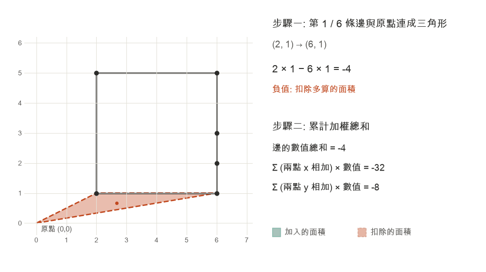
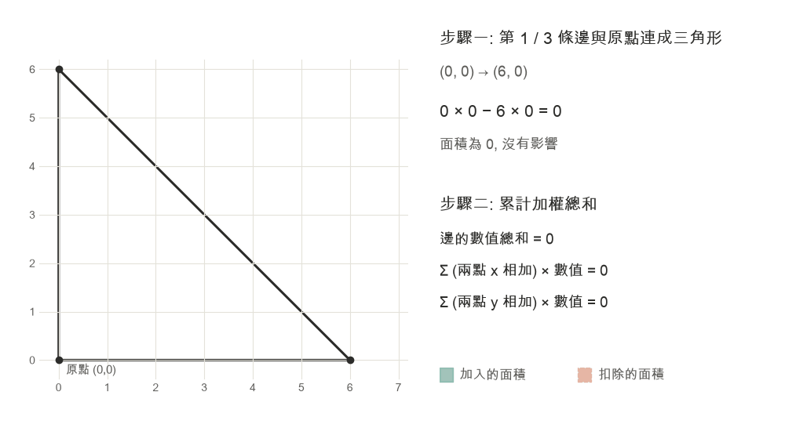

# 問題一
圖像分割 (Image Segmentation) 模型的輸出應用於實際測量學 (Metrology) 任務的題目.

**假設: 在不微調模型的情況下尋找最好的解決方案**

## 資料準備

**要求:** 請用 COCO 資料集, 挑出有兩隻動物 (含或以上) 的圖片, 動物任選.

**回答:** 本題以貓與狗為評估對象, 使用以下圖片:

- `image-segmentation/submission/data/001-test_samples`: 3 張測試圖片
- `image-segmentation/submission/data/002-other_samples`: 9 張新圖, 用於評估模型能力邊界

## 實作模型輸出與應用

### 要求

- R1: 請用 Segmentation 模型將動物的輪廓 / 動物的眼睛個別框出
- R2: 請量測每隻動物, 雙眼的距離
- R3: 請量測任意兩隻動物, 右眼的距離

### 回答

請參照以下 Python 腳本.

#### R1

**方法一: YOLOE** (開放詞彙的圖像分割模型)

- `image-segmentation/submission/scripts/run_yoloe_test_samples.py`

**方法二: YOLOE + DINOv2** (以 ViT 為基礎的特徵模型), 用來找到更多眼睛

- `image-segmentation/submission/scripts/run_yoloe_dinov2_test_samples.py`

#### R2 + R3

量測模式由 `image-segmentation/submission/scripts/config.yaml` 的 `both_eyes` 設定: `both-eyes` 為 R2, `right-eye-pair` 為 R3.

**方法一: YOLOE**

```
.venv/bin/python image-segmentation/submission/scripts/measure_yoloe_eyes.py --json image-segmentation/submission/outputs/001-test_samples_yoloe/002-coco-sample.json
```

**方法二: YOLOE + DINOv2**

```
.venv/bin/python image-segmentation/submission/scripts/measure_yoloe_dinov2_eyes.py --json image-segmentation/submission/outputs/001-test_samples_yoloe_dinov2/grabcut/002-coco-sample.json
```

## 模型與方法論： 解釋使用甚麼 AI 模型, 為什麼, 評估標準公式是甚麼

YOLO 系列是最常用的即時物件偵測與圖像分割模型之一, 在速度與準確度之間取得良好平衡, 模型大小也相對較小.

在本次任務中, YOLOE 在動物分割上表現出色, 但在眼睛這類小部位上準確度偏低.

選用 `Ultralytics` 進行實驗也方便日後將微調後的 `YOLO 模型`導出成不同格式如 `onnx`

- **YOLOE** (`yoloe-26l-seg`): 
  - COCO 沒有 "eye" 類別, 而 YOLOE 可用文字提示 `cat, dog, eye` 直接分割動物與眼睛.

- **限制:** 
  - YOLO 類模型會將影像逐步縮小為較粗的特徵圖, 只有幾個像素大的眼睛在特徵圖上只佔極少的格點, 因此定位特別困難.

  - 將輸入圖放大到 1280x768 後, 找到的眼睛從 5 個增加到 9 個, 但信心分數仍然偏低.

**因此我另外加入 DINOv2, 幫助定位 YOLOE 不易找到的眼睛.**

- **YOLOE + DINOv2** (ViT-S/14): 
  - YOLOE 負責找出動物, 裁切後以 DINOv2 的特徵相似度定位可能是眼睛的位置.
  - 再以 OpenCV 的影像處理 (GrabCut 或熱圖等高線) 描出眼睛輪廓.

- **測試結果:** 
  - 此方法找到 3 張測試圖中全部的貓狗眼睛, 彌補了 YOLOE 漏掉的部分.
  - 在 9 張新圖上, Recall 由 22.6% 提升至 74.2%, 但 Precision 由 77.8% 降至 71.9%.
  - **註: 雖然能定位眼睛, 但輪廓的精準度下降.**

### 模型邊界與限制

_經過幾輪的文獻研究與公開資源測試, 目前在不訓練專屬模型的情況下, 仍難以精準畫出眼睛的輪廓_

本專案的兩個方法雖不完美, 但足以在下列限制內回答問題.

## 評估公式: 解釋量測的方式與公式 , 以及怎麼驗證

#### 動物分割: IoU

$$IoU = \frac{|A \cap B|}{|A \cup B|}$$

- **說明:**
  - $|A \cap B|$: 模型預測輪廓 $A$ 與實際輪廓 $B$ 的交集.
  - $|A \cup B|$: 模型預測輪廓 $A$ 與實際輪廓 $B$ 的聯集.
  - 數值越接近 1 代表重疊越多. COCO 沒有眼睛的標註, 因此只評估動物.

- **計算範例 (示意數字):** 
  - 交集 82 px, 聯集 100 px, $IoU = 82 / 100 = 0.82$.

#### 動物分割: mAP50-95

$$mAP_{50\text{-}95} = \frac{1}{10}\sum_{t=0.50}^{0.95} AP_t$$

- **說明:** 
  - 標籤信心分數 ≥ 門檻?
    - 否: 捨棄該輪廓, 不再檢查 (不計 TP, 也不計 FP)
    - 是: 
      - 依信心分數由高到低排序, 逐一檢查: 類別正確, IoU ≥ $t$, 且該動物尚未被配對?
        - 是: TP, 正確數 +1, 已計輪廓數 +1
        - 否: FP, 正確數 +0, 已計輪廓數 +1
  - 最後, 每隻沒有 TP 的實際動物為 FN (漏掉).
  - $AP_t$: 門檻 $t$ 下的分數. 每隻實際動物得一個分數再取平均: 被找到時為當下的 Precision (正確數 / 已計輪廓數), FN 則為 0.
  - $mAP_{50\text{-}95}$: 將 0.50, 0.55, ..., 0.95 共 10 個門檻的 $AP_t$ 取平均.

- **計算範例 (示意數字):** 
  - 圖中共 4 隻動物 (A, B, C, D), 模型輸出 4 個輪廓, 信心分數門檻 0.1, $t = 0.50$.
    - 標籤 信心分數 0.9, 動物 A, IoU 0.82 → TP, Precision = 1/1 = 1.00
    - 標籤 信心分數 0.8, 動物 B, IoU 0.38 → FP, Precision = 1/2 = 0.50
    - 標籤 信心分數 0.7, 動物 C, IoU 0.67 → TP, Precision = 2/3 = 0.67
    - 標籤 信心分數 0.05, 動物 D → 低於門檻, 捨棄且不再檢查
    - 動物 B 與 D 沒有 TP → FN, 分數為 0.
    - 計算得: $AP_{0.50} = (1.00 + 0.67 + 0 + 0) / 4 = 0.417$.
  - 本專案 10 個門檻的 AP 總和約 5.97: $mAP_{50\text{-}95} = 5.97 / 10 = 0.597$.

### 眼睛定位: Precision, Recall, F1

$$Precision = \frac{TP}{TP+FP} \qquad Recall = \frac{TP}{TP+FN} \qquad F1 = \frac{2 \cdot Precision \cdot Recall}{Precision + Recall}$$

- **說明:**
  - TP: 眼睛的中心落在標註框內即算命中, 每個標註框只計一次. FP 為誤判, FN 為漏掉.
  - Precision 代表找到的有多少是對的, Recall 代表該找到的找到多少, F1 綜合兩者.

- **計算範例 (YOLOE + DINOv2, 9 張新圖):** 
  - 計算合計: TP = 23, FP = 9, FN = 8.
  - $Precision = 23 / (23 + 9) = 71.9\%$
  - $Recall = 23 / (23 + 8) = 74.2\%$
  - $F1 = (2 \times 0.719 \times 0.742) / (0.719 + 0.742) = 0.73$

### 驗證結果

| 動物分割指標 | YOLOE (9 張新圖, 21 隻貓狗) |
|---|---|
| 平均 mask IoU | 0.82 |
| mask AP50 / AP50-95 | 0.901 / 0.597 |

- `image-segmentation/submission/outputs/002-other_samples_yoloe`
  - 兩個方法都使用 YOLOE 的動物輪廓, 因此動物分割結果相同. 
  - 21 隻找到 19 隻且類別全對, 漏掉的 2 隻中有 1 隻是被合併進另一隻貓的輪廓.

| 眼睛定位方法 | 測試圖 F1 | 9 張新圖 Precision / Recall / F1 | 9 張新圖中心誤差 |
|---|---|---|---|
| YOLOE | 0.86 | 77.8% / 22.6% / 0.35 | 2.25 px |
| YOLOE + DINOv2, GrabCut | 1.00 | 71.9% / 74.2% / 0.73 | 1.99 px |
| YOLOE + DINOv2, 熱圖等高線 | 1.00 | 71.9% / 74.2% / 0.73 | 1.75 px |

#### 模型能力限制

- **YOLOE:** 
  - 動物分割可靠, 但眼睛信心分數僅 0.12-0.35, 小、暗或模糊的眼睛常漏掉.
- **YOLOE + DINOv2:** 
  - 找到約 3 倍的眼睛, 但無法回報「看不到眼睛」, 背對鏡頭或暗處會產生誤判 (例如耳朵). 它依賴 YOLOE 的動物輪廓, 漏掉或合併的動物也會跟著出錯, 且只測試過貓與狗.


### 眼睛中心: 形心

$$C_x = \frac{1}{6A}\sum_i (x_i + x_{i+1})(x_i y_{i+1} - x_{i+1} y_i) \qquad C_y = \frac{1}{6A}\sum_i (y_i + y_{i+1})(x_i y_{i+1} - x_{i+1} y_i)$$

- **說明:**
  - 距離需要兩個點, 因此先以形心將每個眼睛輪廓化為一個點作為該眼睛的中心.
  - 使用 $$A = \frac{1}{2}\sum_i (x_i y_{i+1} - x_{i+1} y_i)$$
  - 公式分為三個步驟:
    - 步驟一: 將輪廓的每條邊與`原點 (x0, y0) 圖片起始點` 連成一個三角形並計算其面積. 
    - 步驟二: 以面積作為權重, 計算這些三角形中心的加權總和.
    - 步驟三: 除以總面積 $A$, 得到形心 $(C_x, C_y)$.




- **計算範例 (示意數字):** 
  - 三角形 (0,0), (6,0), (0,6).
  - 三條邊的 $x_i y_{i+1} - x_{i+1} y_i$ 分別為 0, 36, 0, 因此 $A = 36 / 2 = 18$.
  - 只有數值為 36 的邊有影響: $C_x = (6 + 0) \times 36 / (6 \times 18) = 2$.
  - 同理 $C_y = (0 + 6) \times 36 / (6 \times 18) = 2$.
  - 形心為 (2, 2): 大部分面積靠近 (0,0), 因此平衡點不在 (3,3), 而是偏向 (0,0).



### 兩點距離

$$d = \sqrt{(x_2 - x_1)^2 + (y_2 - y_1)^2}$$

- **說明:** 
  - 計算兩個眼睛中心的像素距離.

- **計算範例 1: 每隻動物, 雙眼的距離.** 
  - 需要同一隻動物的兩個眼睛都被找到.


- **計算範例2: 任意兩隻動物, 右眼的距離.** 
  - 在假設動物 **皆正面朝向鏡頭** 的情況下,
  - 即影像中 $x$ 較小的值當作右眼


### 結果評比：MAE 與 MAPE

$$MAE = \frac{1}{n}\sum_i |d_{pred,i} - d_{true,i}| \qquad 

MAPE = \frac{100\%}{n}\sum_i \frac{|d_{pred,i} - d_{true,i}|}{d_{true,i}}$$

- **說明:** 
  - MAE 為量測值與標註值的平均像素誤差
  - MAPE 為該誤差相對於標註距離的百分比

- **計算範例 (YOLOE, 測試圖右眼距離, 2 對):** 
  - 標註點 212.59 / 269.86 px 及 量測點 215.25 / 268.88 px.
  - $MAE = (2.66 + 0.98) / 2 = 1.82$ px
  - $MAPE = (2.66 / 212.59 + 0.98 / 269.86) / 2 \times 100\% = 0.8\%$

### 驗證結果

數值越低代表誤差越小. 各方法量測到的動物數量不同, 因此比較時需一併參考「數量」.

**測試圖: 雙眼距離 (R2)**

| 方法 | 數量 | MAE | MAPE |
|---|---|---|---|
| YOLOE | 4 隻 | 2.52 px | 3.7% |
| YOLOE + DINOv2, GrabCut | 6 隻 | 3.18 px | 6.8% |
| YOLOE + DINOv2, 熱圖等高線 | 6 隻 | 2.04 px | 3.6% |

**測試圖: 右眼距離 (R3)**

| 方法 | 數量 | MAE | MAPE |
|---|---|---|---|
| YOLOE | 2 對 | 1.82 px | 0.8% |
| YOLOE + DINOv2, GrabCut | 3 對 | 2.92 px | 1.2% |
| YOLOE + DINOv2, 熱圖等高線 | 3 對 | 2.09 px | 0.9% |

**9 張新圖: 雙眼距離 (R2)**

| 方法 | 數量 | MAE | MAPE |
|---|---|---|---|
| YOLOE | 2 隻 | 1.95 px | 3.29% |
| YOLOE + DINOv2, GrabCut | 8 隻 | 1.71 px | 8.19% |
| YOLOE + DINOv2, 熱圖等高線 | 9 隻 | 2.17 px | 8.32% |

**限制:**

- 距離為像素而非實際尺寸, 頭部角度與景深會影響結果.
- 右眼的判斷假設動物皆正面朝向鏡頭.
- 眼睛標註由 Claude Code 估計, 再經人工複核, 樣本也很少.