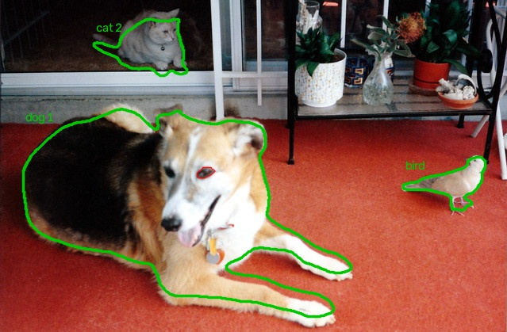
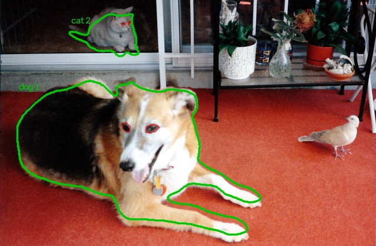
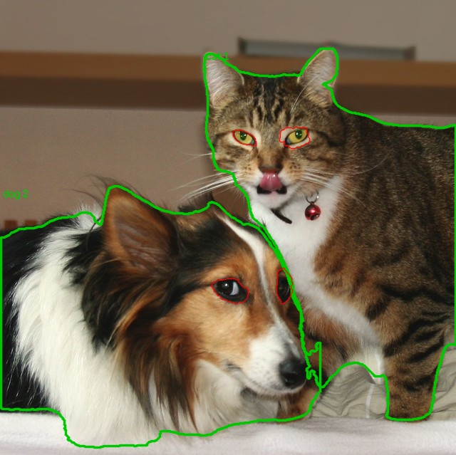
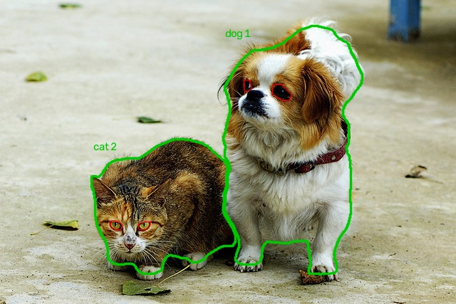

# 2. 動物與眼睛分割

## 概述

有兩種方法描出眼睛輪廓. 兩者都使用 YOLOE 描出動物輪廓.

| 方法 | 動物輪廓 | 眼睛輪廓 |
|---|---|---|
| **YOLOE** | YOLOE, 提示為 `bird, cat, dog` | YOLOE, 提示為 `eye` |
| **YOLOE + DINOv2** | YOLOE | DINOv2 熱圖峰值, 以 GrabCut 或熱圖等高線描出輪廓 |

YOLOE + DINOv2 有兩種描輪廓的方式, 兩者都會列出結果:

- **GrabCut:** 依小視窗中的顏色, 將每個眼睛與周圍分離.
- **熱圖等高線:** 在每個眼睛峰值一半高度處描出熱圖輪廓.

圖中的動物為綠色, 眼睛為紅色.

## YOLOE + DINOv2 的運作方式

```text
YOLOE 動物輪廓 → 裁切動物 → DINOv2 區塊特徵
→ 與參考眼睛的相似度 (熱圖) → 保留動物輪廓內的峰值
→ 選出最多 2 個峰值 → GrabCut 或熱圖等高線 → 眼睛輪廓
```

此專案沒有訓練模型. 參考眼睛是測試樣本中 YOLOE 眼睛輪廓下的 DINOv2 特徵.
在測試樣本上, 裁切圖的參考眼睛只來自其他測試樣本. 在其他樣本上, 則來自全部 3 張測試樣本.

## 測試樣本

| 圖片 | YOLOE | YOLOE + DINOv2, GrabCut | YOLOE + DINOv2, 熱圖等高線 |
|---|---|---|---|
| 001 |  |  |  |
| 002 |  |  |  |
| 003 |  |  |  |

YOLOE 找到全部 7 隻動物, 包含鳥. YOLOE + DINOv2 只處理貓與狗, 因此鳥沒有該方法的眼睛結果.

## 其他樣本

| 方法 | 描出輪廓的貓狗 | 輸出眼睛 | 有兩個眼睛的動物 |
|---|---|---|---|
| YOLOE | 25 | 18 | 7 |
| YOLOE + DINOv2, 任一方式 | 25, 來自 YOLOE | 48 | 23 |

兩種方式都從相同的眼睛位置開始, 因此輸出的眼睛數量相同. YOLOE 也找到了圖片 001 中的鳥.
在 `000000333772.jpg` 中, YOLOE 用一個輪廓框住 2 隻貓, 因此 YOLOE + DINOv2 將牠們視為一隻動物.

全部 12 張圖片的總覽:

- [YOLOE](files/figures/other_samples/yoloe.jpg)
- [YOLOE + DINOv2, GrabCut](files/figures/other_samples/dinov2_grabcut.jpg)
- [YOLOE + DINOv2, 熱圖等高線](files/figures/other_samples/dinov2_heatmap_level.jpg)
- [DINOv2 熱圖, 每張並列其裁切圖](files/figures/other_samples/dinov2_heatmaps.jpg)

完整尺寸的結果與 JSON 輪廓位於 [`outputs/`](../outputs).
